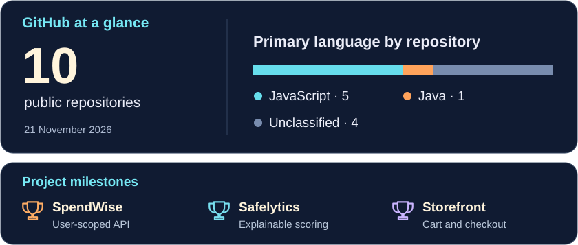

# Hi, I'm Jeevan 👋

I'm a Computer Science and Engineering student at **Atria Institute of Technology, Bengaluru**. I build full-stack apps with React and Node.js. Two questions drive my recent projects: *Where did my money go this month?* and *What should a parent know before a child opens a website?*

[Featured projects](#featured-projects) · [Tech stack](#tech-stack) · [GitHub stats](#github-stats)

## Tech stack

## Featured projects

### SpendWise
A personal expense tracker with a searchable transaction history and spending by category. Each API query uses the signed-in user's ID, so the dashboard shows that person's records.

[View SpendWise](https://github.com/jeevan0354/Spendwise) · [Read the transaction routes](https://github.com/jeevan0354/Spendwise/blob/main/backend/routes/transactionRoutes.js)

### Safelytics
A website safety analyzer for parents and educators. It compares MiniLM results with keyword matches, then explains which content and privacy signals contributed to the score.

**Built with** Python, MiniLM and ONNX.

### JavaScript storefront
An Amazon-style storefront with separate cart and checkout pages. Start with the cart code to follow the shopping flow.

[View the storefront](https://github.com/jeevan0354/amazon-clone-fullstack) · [Read the cart code](https://github.com/jeevan0354/amazon-clone-fullstack/blob/main/cart.js)

## GitHub stats

[Browse my repositories](https://github.com/jeevan0354?tab=repositories) · [See my latest contribution activity](https://github.com/jeevan0354#js-contribution-activity)
